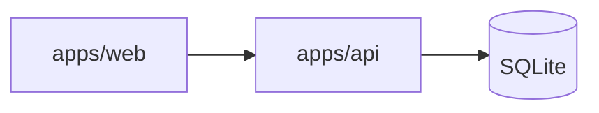
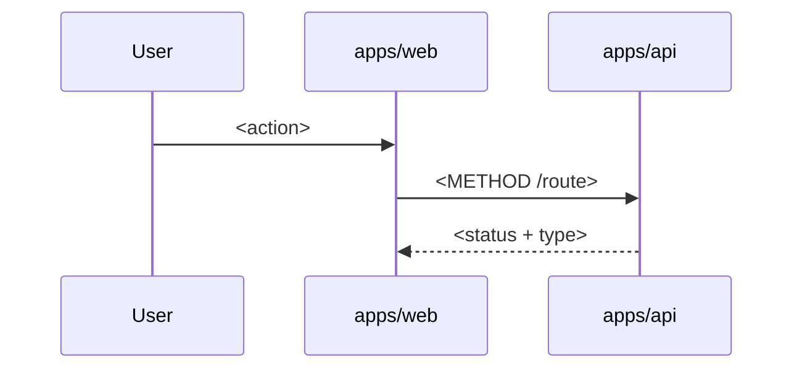
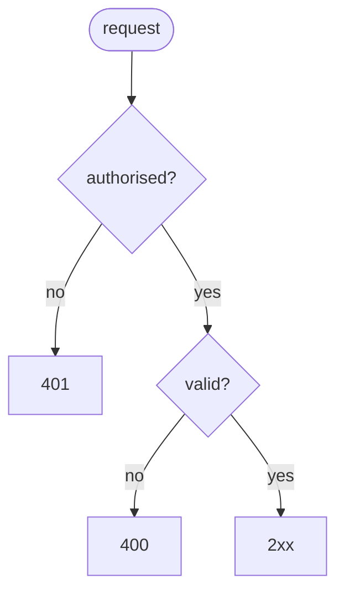

# <Title>

Issue: #<issue> · Track: full · Branch: `feature/<issue>-<slug>`

## 1. Problem

**Acceptance criteria** (from the issue, verbatim)

- [ ] **AC1** — ...

Prior art: <or "none">

## 2. Spec

### 2.1 What the change does

- **S1** — When <actor> <does something>, <observable result>.

### 2.2 How we'll know it works

| Proves | Evidence | Kind |
|---|---|---|
| S1, AC1 | `<file> > <describe> > <it>`: <assertion> | unit / integration / e2e |

### 2.3 What it must not break

| # | Must keep working | Guarded by |
|---|---|---|
| N1 | <neighbour> | existing `<test>` (opened) / new `<test>` |

### 2.4 How we'll debug it at 3 am

| # | When this fails | How we find out | What localises it | What it tells us · first action |
|---|---|---|---|---|
| O1 | | | | |

## 3. Where it fits

## 4. Main flow

## 5. Control flow

## 6. Data model and states

<!-- Prisma schema diff, erDiagram, stateDiagram-v2, or "n/a — reason". Name the migration. -->

## 7. Affected parts

| Workspace | What changes | Importers of changed shared types |
|---|---|---|

## 8. Caveats

<!-- references/caveats.md, row by row: an answer or `n/a — reason`. -->

## 9. Concurrency and idempotency

| Race / retry | Mechanism | Code it relies on | Observable outcome |
|---|---|---|---|

## 10. Decisions

- **D1** — <decision> · because <rationale> · rejected: <alternative>

## Review outcome

<!-- Spec check and risk map from design-reviewer, verbatim; then Accepted: lines. -->
