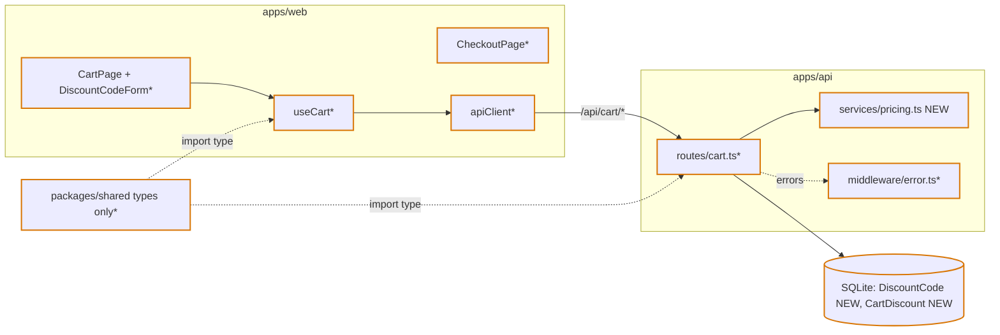
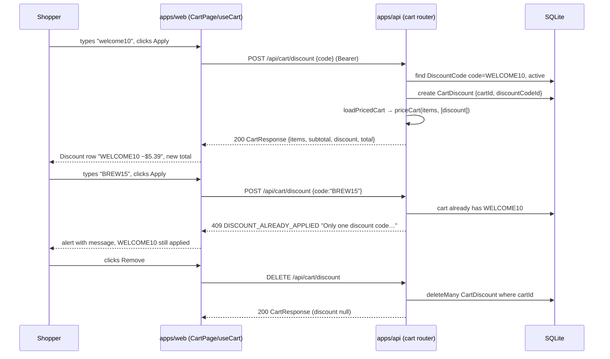
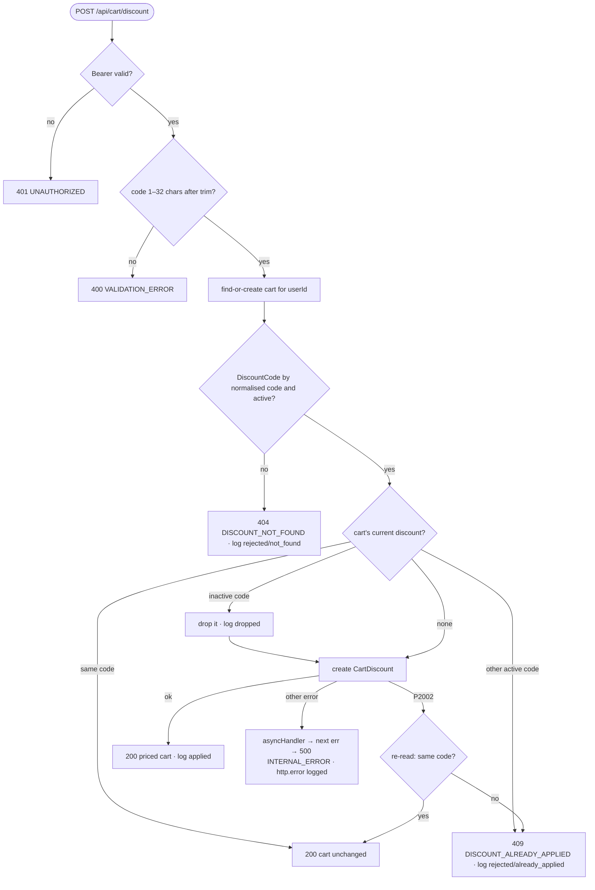
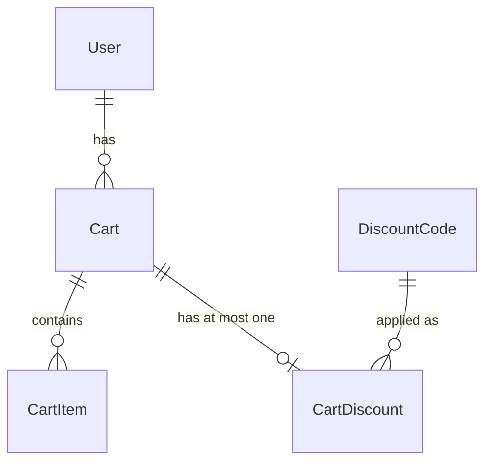

# Add discount code support to the demo application

Issue: #3 · Track: full (Prisma schema change + shared `Cart` contract change + 3 workspaces) · Branch: `feature/3-discount-codes`

## 1. Problem

Shoppers on the Zava coffee storefront cannot apply a discount code. When codes are added, only one
code or offer may be active per cart so that discounts cannot stack into unreasonably low prices.
The design must leave room for combinable discounts later without building them now.

**Acceptance criteria** (from the issue, verbatim)

- [ ] **AC1** — A user can apply a valid discount code and the discount is reflected in the price.
- [ ] **AC2** — Applying a second discount code or offer while one is active is not allowed, and the user can tell why.
- [ ] **AC3** — The discount code applies to every product in the application.
- [ ] **AC4** — No sequence of actions results in stacked discounts.

**Product decisions taken in planning (2026-11-11):** percentage codes only; the server caps any
discount at 50% of the subtotal; the free-shipping threshold uses the **pre-discount** subtotal; the
code is entered on the **cart page** only (checkout shows it read-only).

Out of scope (from the issue): combining discounts, product/category exclusions. Also out of scope:
an admin UI for codes (codes are seeded), expiry dates, per-user usage limits, persisting placed
orders (checkout is still a client-side mock), and making `Cart.userId` unique (pre-existing gap,
follow-up).

Prior art: none. No `discount|coupon|promo|offer` anywhere in `apps/` or `packages/`. The only
offer-like rule is client-side free shipping ≥ $75 in `apps/web/src/pages/CheckoutPage.tsx:14`;
it stays and is not treated as a discount (D6).

## 2. Spec

### 2.1 What the change does

- **S1** — When a signed-in shopper submits an active code on the cart page, the API attaches it to
  their cart and every cart response returns `subtotal`, `discount` (exactly `{ code, percentOff,
  amount }`, or `null`) and `total = subtotal − discount.amount`.
- **S2** — Codes are matched case-insensitively after trimming (`" welcome10 "` = `WELCOME10`).
- **S3** — The discount is `floor(subtotal × clamp(percentOff, 0, 50) / 100)` cents, over **all**
  cart items regardless of product or category; `total` is never below 0 and never above `subtotal`.
- **S4** — Submitting a different code while one is applied is rejected with `409
  DISCOUNT_ALREADY_APPLIED` and the message "Only one discount code can be used per order. Remove
  WELCOME10 to use a different code."; the cart page shows that message and the original discount stays.
- **S5** — Submitting the code that is already applied returns `200` with the unchanged cart (idempotent).
- **S6** — An unknown or inactive code is rejected with `404 DISCOUNT_NOT_FOUND`, "This discount code
  is not valid."; a malformed body with `400 VALIDATION_ERROR`.
- **S7** — The shopper can remove the applied code (`DELETE /api/cart/discount` → `200` cart with
  `discount: null`; also `200` when none is applied), after which another code can be applied.
- **S8** — The discount is recalculated from current items on every cart response (read, add item,
  apply, remove code).
- **S9** — Checkout's order summary shows a "Discount (CODE)" row; Place Order shows
  `cart.total + shipping`, where shipping is free when the **pre-discount** subtotal ≥ $75.
- **S10** — At most one discount can be attached **per cart**, enforced by the database (unique
  `CartDiscount.cartId`), not only by handler logic.
- **S11** — Each outcome of the apply/remove handlers (applied, rejected not_found, rejected
  already_applied, removed, dropped) writes one structured log line. Requests stopped earlier by
  `authenticate` (401) or `validate()` (400) are not logged, as today.
- **S12** — If the applied code has been deactivated, the next cart response from **any** cart route
  drops it (row deleted, `discount: null`, `discount.dropped` logged); another code can then be applied.
- **S13** — A discount stays attached when the cart becomes empty (amount 0). The empty-cart view
  shows "WELCOME10 will apply to your next items · Remove" so it is never invisible. Applying a code
  to an empty cart via the API is allowed (200, amount 0); the UI form only shows on a non-empty cart.
- **S14** — Any unexpected error in a cart route (existing and new), **including a DB error inside
  `authenticate`**, and in `POST /api/auth/login` and `/register` (which the web calls automatically
  after a 401), returns `500 INTERNAL_ERROR` with an `http.error` log line, and the API process keeps
  running. `authenticate` returns 401 only for JWT errors (`JsonWebTokenError`, `TokenExpiredError`)
  or a missing user.
- **S15** — While a code is applied, the cart page shows "WELCOME10 −$11.09 · Remove" **and keeps the
  code input**, so a second code can be tried and the S4 message is shown (product decision, Stage 2).
  `discountError` clears on a successful apply or remove.

### 2.2 How we'll know it works

| Proves | Evidence | Kind |
|---|---|---|
| S3, AC3 | `apps/api/src/services/pricing.test.ts > priceCart >` `applies percent to all items across categories`; `floors to whole cents`; `caps at 50%`; `percentOff ≤ 0 → discount 0`; `never below 0`; `no discount → total = subtotal` | unit |
| S1, AC1 | `routes.test.ts > Discount API > applies a valid code`: 200, `discount.amount` = 10% of subtotal, `total = subtotal − amount`; `discount` has exactly keys `code, percentOff, amount` | integration |
| S2 | `> matches code case-insensitively and trimmed` | integration |
| S4, AC2 | `> rejects a second different code with 409 DISCOUNT_ALREADY_APPLIED`; follow-up GET still shows the first code | integration |
| S5 | `> re-applying the same code is idempotent (200, same amount)` | integration |
| S6 | `> unknown code → 404`; `> inactive code → 404`; `> empty code → 400` | integration |
| S7 | `> DELETE /api/cart/discount removes it, then a new code applies`; `> DELETE with none applied → 200` | integration |
| S8 | `> adding items recalculates discount`; `> removing an item then GET recalculates` | integration |
| S10, AC4 | (1) `> DB rejects a second CartDiscount for the same cart with P2002`; (2) `> P2002 path returns 409 when pre-check is bypassed` (`vi.spyOn(prisma.cartDiscount,'findUnique').mockResolvedValueOnce(null)` with a row present; asserts log `via:"P2002"`); same-code variant → 200; (3) `> concurrent applies of two codes on an existing cart → one 200, one 409, one row` (GET first so the cart exists) | integration |
| S11 | `> logs discount.applied / rejected(reason) / removed` via `console.info` spy | integration |
| S12 | `> deactivated code: GET returns discount null, logs discount.dropped, then BREW15 applies 200`; `> POST /items after deactivation → discount null` | integration |
| S13 | `> removing the last item keeps the discount attached (amount 0)`; `CartPage.test.tsx > empty cart with discount shows code and Remove` | integration / unit (RTL) |
| S14 | `> GET /api/cart → 500 INTERNAL_ERROR when prisma throws` (`vi.spyOn(prisma.cart,'findFirst').mockRejectedValueOnce`); same for `POST /items`, `DELETE /items/:id`, `POST`/`DELETE /discount`; `> 500 when authenticate's user lookup throws`; `POST /api/auth/login → 500 when prisma throws`; each asserts `http.error` with method, path, userId and that a `process.on('unhandledRejection')` spy is never called | integration |
| S15 | `DiscountCodeForm.test.tsx > with a discount applied, submitting another code calls onApply and the 409 alert renders`; `> focus returns to the input after an error`; `useCart.test.tsx > successful apply / remove clears discountError` | unit (RTL) |
| AC2 (UI) | `apps/web/src/components/DiscountCodeForm.test.tsx > shows the server's 409 message in role=alert and keeps the applied code` | unit (RTL) |
| AC1 (UI) | `CartPage.test.tsx > renders server subtotal, discount row and total` | unit (RTL) |
| S9 | `CheckoutPage.test.tsx > shows "Discount (WELCOME10)" and Place Order = cart.total + shipping` | unit (RTL) |
| AC1–AC4 end to end | Manual journey in plan §3 (apply, second code, remove, re-apply, checkout) | manual |

### 2.3 What it must not break

| # | Must keep working | Guarded by |
|---|---|---|
| N1 | `GET /api/cart` still returns `items[]` and `total` (= subtotal with no code); empty cart total 0 | existing `Cart API > returns empty cart for new user` (opened) + new assert `subtotal === total && discount === null` |
| N2 | `POST /api/cart/items` add/increment, stock check, unknown product | existing add/increment tests (opened, cover only happy path) + **new** `→ 404 for unknown product`, `→ 400 when quantity > stock` |
| N3 | `DELETE /api/cart/items/:id` stays `204`; a user cannot delete another user's item | existing `removes item` (204 only) + **new** `DELETE another user's item → 404 and item still exists` |
| N4 | Deleting carts/users (test setup, `db:seed`) still works with the new FK | `onDelete: Cascade` on `CartDiscount.cart`; existing `beforeAll` `cart.deleteMany()` keeps passing; `npm run db:seed` in verification |
| N5 | Free shipping when pre-discount subtotal ≥ $75; $8.95 otherwise | **new** `CheckoutPage.test.tsx > subtotal 7600 with 10% off (total 6840) still ships free`; `> subtotal 5000 → $8.95` |
| N6 | Cart and discount routes stay auth-only; shoppers only touch their own cart | existing `GET /api/cart requires auth` + **new** `POST /api/cart/discount requires auth`, `user B applying a code leaves user A's cart unchanged` |
| N7 | Header cart count reflects the cart after mutations | **new** `useCart.test.tsx > itemCount updates after removeItem` (API mocked); existing `Header.test.tsx` (prop-only) |
| N8 | Test SQLite and Docker Postgres schemas stay in step with dev schema | same diff in `schema.prisma`, `schema.test.prisma`, `schema.docker.prisma`; `npm test` runs `db push` on the test schema |
| N9 | Docker API container starts (API must not runtime-import `@zava/shared`, whose `exports` point at `src/*.ts` while the image copies only `dist`) | API uses `import type` only; manual `docker compose up --build api` → `GET /api/health` 200 |
| N10 | Removing an item does not flash the page or unmount the discount form | **new** `CartPage.test.tsx > removing an item keeps the summary rendered and shows the server total` |
| N11 | Web still type-checks after the shared `Cart`/`CartItem` change (Vitest does not type-check) | `npm run build` (`tsc -b`) in verification |

### 2.4 How we'll debug it at 3 am

Logging today is bare `console`; `apps/api/src/middleware/error.ts:4` logs only `err.message`. New
lines are single-line JSON from `apps/api/src/lib/log.ts` `logEvent(event, fields)` so they are
greppable. No passwords or tokens are logged; codes and cuids are not secrets.

| # | When this fails | How we find out | What localises it | What it tells us · first action |
|---|---|---|---|---|
| O1 | Valid code keeps being rejected | Shopper report / many rejections | `{"event":"discount.rejected","reason":"not_found","code","cartId","userId"}` | Code missing or `active=false` → check the `DiscountCode` row; re-seed in demo |
| O2 | Shopper cannot switch codes | Report "my code won't work" | `discount.rejected` `reason:"already_applied"`, `appliedCode` | As designed; shopper removes the first code. If no Remove button is visible, web bug (see S13) |
| O3 | Wrong discount amount or total | Report or demo check | `{"event":"discount.applied","cartId","code","percentOff","subtotal","amount","total"}`; response fields `subtotal/discount/total` | Compare with S3 formula; reproduce in `pricing.test.ts` with the logged numbers |
| O4 | DB error inside a cart route, `authenticate`, or login/register | 500 in the browser network tab (no longer a silent 401) | `errorHandler` line `{"event":"http.error","method","path","userId","message"}` on stderr | Before this change, a DB outage surfaced first as an **unlogged 401** from `authenticate`. The web then re-logged in automatically through the unwrapped login handler, and that async rejection in Express 4 on Node ≥ 15 **killed the process** (no `unhandledRejection` handler, no compose restart policy). Now `authenticate` forwards non-JWT errors, and cart and auth handlers use `asyncHandler`. First action: check the DB file/connection named in the message |
| O5 | Unique-constraint race (two tabs) | One tab shows the 409 message | `discount.rejected` `reason:"already_applied"`, `via:"P2002"` | Expected under concurrency; investigate only if it appears without it |
| O6 | Applied code later deactivated | Discount disappears from the cart | `{"event":"discount.dropped","reason":"inactive","cartId","code"}` | Code deactivated in DB; expected |
| O7 | Shopper removed a code | Support question "my discount vanished" | `{"event":"discount.removed","cartId","code"}` | Shopper action; no fix needed |

## 3. Where it fits



## 4. Main flow



## 5. Control flow (POST /api/cart/discount)



`DELETE /api/cart/discount`: auth → `deleteMany({ cartId })` → log `discount.removed` when a row was
deleted → `200` priced cart. `GET /api/cart` and `POST /api/cart/items`: unchanged logic, then
`loadPricedCart`, which drops an inactive code (S12). All cart handlers are wrapped in `asyncHandler`.

## 6. Data model and states

Applied to **all three** schema files (`schema.prisma`, `schema.test.prisma`,
`schema.docker.prisma`). The repo has no `prisma/migrations` folder and uses `prisma db push`
(`apps/api/package.json` `db:push`, `scripts/run-vitest.mjs`), so there is no named migration. The
change is additive (two new tables and a back-relation), and existing rows need no backfill.

```prisma
model Cart {
  // ...existing fields
  cartDiscount CartDiscount?        // relation named cartDiscount so it never collides with the response field `discount`
}

model DiscountCode {
  id         String         @id @default(cuid())
  code       String         @unique   // stored upper-case
  percentOff Int                      // pricing clamps to 0–50 (S3)
  active     Boolean        @default(true)
  createdAt  DateTime       @default(now())
  updatedAt  DateTime       @updatedAt
  carts      CartDiscount[]
}

model CartDiscount {
  id             String       @id @default(cuid())
  cartId         String       @unique   // one discount per cart (S10)
  cart           Cart         @relation(fields: [cartId], references: [id], onDelete: Cascade)
  discountCodeId String
  discountCode   DiscountCode @relation(fields: [discountCodeId], references: [id])
  appliedAt      DateTime     @default(now())
}
```



The response is built explicitly by `toCartResponse(cart, priced)`, never by spreading the Prisma
object, so `discountCodeId`, `appliedAt` and `active` never leak (P1).

Seed (`apps/api/prisma/seed.ts`): `WELCOME10` (10%), `BREW15` (15%) and `RETIRED20` (20%,
`active: false`). Cleanup deletes `cartDiscount`, then `discountCode`, before carts.

## 7. Affected parts

| Workspace | What changes | Importers of changed shared types |
|---|---|---|
| packages/shared | **Types only, no runtime values.** `CartItem` is corrected to the wire shape (`id, productId, quantity, product: { id, name, price, imageUrl }`). `Cart` gains `subtotal`, `discount: AppliedDiscount \| null`, with dates as `string` and `total` documented as post-discount. New `AppliedDiscount { code, percentOff, amount }` and `ApplyDiscountInput { code }` | Nothing imports `Cart`/`CartItem` from `@zava/shared` today; only `formatPrice` is used. After the change, `apps/web/src/hooks/useCart.tsx` replaces its local interfaces with the shared ones, and `apps/api/src/routes/cart.ts` uses `import type` |
| apps/api | `prisma/*.prisma` ×3 and `seed.ts`. New `src/services/pricing.ts` (pure `priceCart(subtotalItems, discounts[])`, `MAX_DISCOUNT_PERCENT = 50` lives here) with its test. New `src/lib/asyncHandler.ts` and `src/lib/log.ts`. `routes/cart.ts` gets one `loadPricedCart(cartId)` + `toCartResponse` used by GET, POST items and the new `POST`/`DELETE /discount`, and every handler is wrapped. `middleware/error.ts` logs method, path and userId as JSON. `middleware/auth.ts` returns 401 only for JWT errors and calls `next(err)` otherwise. `routes/auth.ts` wraps login and register | — |
| apps/web | `apiClient.ts` gets `applyDiscount`/`removeDiscount`. `useCart.tsx` uses the shared types, exposes `applyDiscount`, `removeDiscount` and `discountError`, and gains a silent `refreshCart()` that doesn't toggle `loading`; `removeItem` calls it instead of recomputing `total`. New `components/DiscountCodeForm.tsx` with its test. `CartPage.tsx` uses the server's `subtotal/discount/total` and shows an attached code on the empty view. `CheckoutPage.tsx` shows the discount row and computes shipping on `subtotal`. New `CartPage.test.tsx`, `CheckoutPage.test.tsx`, `useCart.test.tsx` | — |
| docs | `docs/api-reference.md` cart section, which also fixes existing drift (the response isn't wrapped in `data`, and DELETE item returns `204`). `docs/architecture.md` data model, noting that one cart per user is not enforced. `README.md:83-84` response shapes (error is `{ message, code, statusCode }`; cart success is not wrapped in `{ data }`). Feature index | — |

## 8. Caveats

- **Neighbours** — Totals are computed in 4 places today: `cart.ts` GET and POST, `useCart.tsx:161`
  (removeItem), `CartPage.tsx:12` and `CheckoutPage.tsx:13`. All client-side recomputation goes, and the
  server becomes the only pricing source (D3). → N1–N3, N5, N10.
- **Shared types** — The `CartItem` and `Cart` changes have no importers today. When web adopts them,
  `tsc -b` is the guard (N11). Shared stays type-only because the Docker API image can't resolve
  shared at runtime (N9, D8).
- **Validation** — Zod `{ code: z.string().trim().min(1).max(32) }` through the existing `validate()`.
  The server upper-cases the code, not the UI.
- **Error mapping** — New codes `DISCOUNT_NOT_FOUND` (404) and `DISCOUNT_ALREADY_APPLIED` (409) in the
  existing `{ message, code, statusCode }` shape. `apiClient` already surfaces `message` through
  `ApiError`. Unknown errors go through `asyncHandler` → `errorHandler` → 500, with no stack in the body.
- **Auth** — The routes sit under `cartRouter.use(authenticate)`, and the cart is always found by
  `req.userId` (N6). No role change.
- **Observability** — Async rejections in Express 4 used to crash the process. All cart handlers are
  now wrapped (S14, O4). Products and auth routes have the same gap, which is out of scope and listed
  as a follow-up.
- **Tests** — New `Discount API` block, guard tests for N2/N3/N6, and `pricing.test.ts`. Web gets
  `CartPage`, `CheckoutPage`, `useCart` and `DiscountCodeForm` tests, using the RTL setup already in
  `test-setup.ts`.
- **Migration safety** — The tables are additive and the back-relation is optional. All three schema
  files must match (N8).
- **Seed data** — Three codes and a new cleanup order (N4).
- **Queries** — `loadPricedCart` is one `findFirst` with `include: { items: { include: { product } },
  cartDiscount: { include: { discountCode } } }`. Its size is bounded by the cart and it has no N+1.
  `DiscountCode.code` is `@unique` (indexed). Pre-existing issue: `Cart.userId` isn't unique, so
  find-or-create can race to two carts. The guarantee is therefore per cart (S10), and the fix is a
  follow-up.
- **Transactions** — Apply is a single insert. Dropping an inactive code before inserting is two
  writes: if the insert fails, the cart simply has no discount, which is a safe state. Remove is one
  `deleteMany`.
- **Contract docs** — `docs/api-reference.md` is updated, including the drift, and so is `README.md:83`.
- **Compatibility** — The new fields are additive, and `total` keeps its value when no code applies.
  The only client is `apps/web`.
- **Idempotency** — Re-applying the same code returns 200 (on the P2002 path too). DELETE with no code
  applied returns 200. Apply is disabled while a request is pending.
- **States (web)** — The form has four states: idle, submitting (button disabled), error
  (`role="alert"`) and applied (code, amount, Remove). An empty cart with a code shows the code and
  Remove (S13). Removing an item never unmounts the page (N10).
- **Accessibility** — The input has a `<label htmlFor>`, the button is a `<button type="submit">`
  inside a `<form>`, the error has `role="alert"`, and focus stays on the input after an error.
- **User-supplied content** — The code is echoed only as React text, never as HTML.
- **Stale data** — Every mutation sets the cart from the server response; removing an item does a
  silent refresh.
- n/a: Config and secrets (no new env vars). Limits (≤ 32-character string under the default
  `express.json()` limit). AI rows (no model involved).

## 9. Concurrency and idempotency

| Race / retry | Mechanism | Code it relies on | Observable outcome |
|---|---|---|---|
| Two tabs apply different codes on one cart | DB unique on `CartDiscount.cartId`; the handler catches Prisma `P2002` and re-reads | `prisma.cartDiscount.create` in `POST /discount` | One 200 and one 409 `DISCOUNT_ALREADY_APPLIED`, leaving one row (S10, AC4) |
| Double-click or retry of the same code | Same-code pre-check. If the insert races itself, the `P2002` re-read sees the same code and returns 200 | `POST /discount` handler | 200 both times, one row |
| Remove while an apply is in flight | Either order ends with 0 or 1 row, and the response reflects the DB after the write | `deleteMany` + `loadPricedCart` | UI shows the server's final state |
| Items change after a code is applied | The discount is stored as a reference and the amount is computed on read | `priceCart` in `loadPricedCart` | Amount always matches the current items (S8) |
| Two carts for one user (pre-existing find-or-create race) | Not fixed here. Each cart can carry at most one discount, and the shopper only ever sees the one `findFirst` returns | `cart.ts` find-or-create | No stacking within a cart; follow-up to make `userId` unique |

## 10. Decisions

- **D1** — Store the applied discount in a `CartDiscount` table with `@unique cartId`.
  - **Because:** the database then rules out stacking, even under races. Combining discounts later means dropping the unique, changing the relation from `CartDiscount?` to `CartDiscount[]` (which touches the includes and `toCartResponse`), and changing the pricing policy.
  - **Rejected:** a nullable `Cart.discountCodeId` column. It is also race-safe, but combining later would need a new table and a data move.
- **D2** — Percentage codes only, clamped to 0–50% in `priceCart`.
  - **Because:** the product owner chose it, and a mis-seeded or negative code can then neither give goods away nor raise the price.
  - **Rejected:** fixed-amount codes, which need minimum-order rules.
- **D3** — The server is the single pricing source. `priceCart(items, discounts[])` in `apps/api/src/services/pricing.ts` is a pure function that takes an **array** and applies a single-discount policy.
  - **Because:** four client-side recomputations would drift apart, and the array is where combining plugs in later.
  - **Rejected:** a shared pricing utility used by web, which would mean two places enforcing the cap.
- **D4** — A different second code is rejected with 409, not swapped in.
  - **Because:** AC2 says a second code "is not allowed, and the user can tell why".
  - **Rejected:** last code wins.
- **D5** — Round the discount down to whole cents.
  - **Because:** prices are integer cents, and rounding should favour the shop.
  - **Rejected:** `Math.round`.
- **D6** — Free shipping (≥ $75) is a shipping rule, not an "offer". It stays client-side and keeps using the pre-discount subtotal.
  - **Because:** the product owner chose it, and it keeps existing behaviour (N5).
  - **Rejected:** a post-discount threshold.
- **D7** — Codes are seeded; there is no admin CRUD.
  - **Because:** it is out of the issue's scope.
- **D8** — `packages/shared` carries only types for this feature, and the API imports them with `import type`.
  - **Because:** the shared `exports` resolve to `src/*.ts`, which the Docker runtime image doesn't contain (N9).
  - **Rejected:** a shared runtime constant, or fixing the shared build/exports (separate concern, follow-up).
- **D9** — Wrap every cart handler, old and new, plus `POST /api/auth/login` and `/register`, in `asyncHandler`, and make `authenticate` forward non-JWT errors.
  - **Because:** this change routes more work through these paths, including a write on read (S12). Today a DB outage turns into a silent 401, then an automatic re-login, then a process crash (Stage 2 B1).
  - **Rejected:** wrapping only the new routes.
- **D10** — Keep the code input visible while a code is applied (S15).
  - **Because:** the product owner chose it at Stage 2, and it lets the shopper see AC2's "why" message in the UI.
  - **Rejected:** hiding the input behind Remove.

No ADR: these rules are local to this feature. A future feature that adds combinable discounts should
write the ADR for the stacking policy.

Follow-ups (not in this feature): make `Cart.userId` unique; wrap the products handlers; fix the
shared package's runtime exports for Docker; add ESLint, since `npm run lint` can't run today (no
eslint binary or config).

## Review outcome

**Stage 1 — design-reviewer, 2026-11-11, verdict: blocked** (spec check and risk map verbatim)

Spec check
- **What the change does**: ok — S1–S11 cover AC1–AC4 and are observable; one undocumented behaviour (inactive-code drop, §5/O6) has no S-row (S2).
- **How we'll know it works**: gaps (should-fix) — S9 and AC1 (UI) are manual-only; S10's DB constraint and the P2002 branch are not reliably proved; O6 untested.
- **What it must not break**: gap (**blocker**) — N2, N3, N6, N7 cite existing tests that do not test what they claim; three neighbours missing (Docker API runtime, the loading-flash on remove, web typecheck).
- **How we'll debug it at 3 am**: gap (**blocker**) — O4 misstates the failure mode: an unwrapped async handler error **crashes the API process**, not "hangs the request", and the design routes more work (including a new write on GET) through handlers it leaves unwrapped.

Risk map
1. **Async error handling in the cart router** — `apps/api/src/routes/cart.ts:18,36,80`, no `try`/`catch` in any route file. Dangerous because: on Node 20 an async Express 4 rejection terminates the process; the design adds a `deleteMany` write to `GET /api/cart` and more joins to every cart read, but wraps only new handlers. Verify by hand: every handler that calls `loadPricedCart` forwards errors to `next(err)`.
2. **`@zava/shared` runtime import in Docker** — `packages/shared/package.json` exports, `apps/api/Dockerfile:54-55`. Dangerous because: the API has never runtime-imported shared; the plan puts a value (`MAX_DISCOUNT_PERCENT`) there, so the Docker API dies at startup. Verify by hand: API imports from shared are `import type` only.
3. **"One discount per cart" vs per user, and the P2002 path** — `schema.prisma:39`, `cart.ts:19-29`, `cart.ts:50-53`. Dangerous because: `Cart.userId` is not unique and find-or-create races; the concurrency test only proves S10 when the cart pre-exists and the interleaving happens to hit it. Verify by hand: deterministic constraint and handler tests (S1).

Findings and how they were resolved
- **B1** async handlers / O4 → fixed: D9, S14, O4 rewritten, `asyncHandler` on every cart handler, `errorHandler` logs method/path/userId, 500-path tests in §2.2.
- **B2** guards don't test what they claim → fixed: N2, N3, N6, N7 now name new tests.
- **B3a** Docker runtime import → fixed: constant moved to `pricing.ts`, shared is type-only (D8), N9.
- **B3b** loading flash on remove → fixed: silent `refreshCart()`, N10.
- **B3c** web typecheck / shared `CartItem` wrong shape → fixed: shared `CartItem` corrected to wire shape (§7), N11 `npm run build`.
- **S1** flaky race test → fixed: three deterministic tests in §2.2 S10 row; S10 reworded "per cart".
- **S2** inactive-code drop unspecified / GET-only → fixed: S12, drop lives in `loadPricedCart`.
- **S3** UI manual-only → fixed: `CartPage`/`CheckoutPage` RTL tests.
- **S4** S11 over-promises → fixed: S11 narrowed, `discount.removed` (O7) added.
- **P1** relation/field name clash and spread leak → fixed: relation `cartDiscount`, explicit `toCartResponse`, exact-keys test.
- **P2** `percentOff` range unenforced → fixed: clamp 0–50, `≤ 0` test.
- **P3** discount hidden on empty cart → fixed: S13.
- **P4** README error shape, D1 wording → fixed: README in §7 docs, D1 reworded.

Remaining findings: none.

**Stage 1 gate:** approved by Mattias Jonsson, 2026-11-11.
